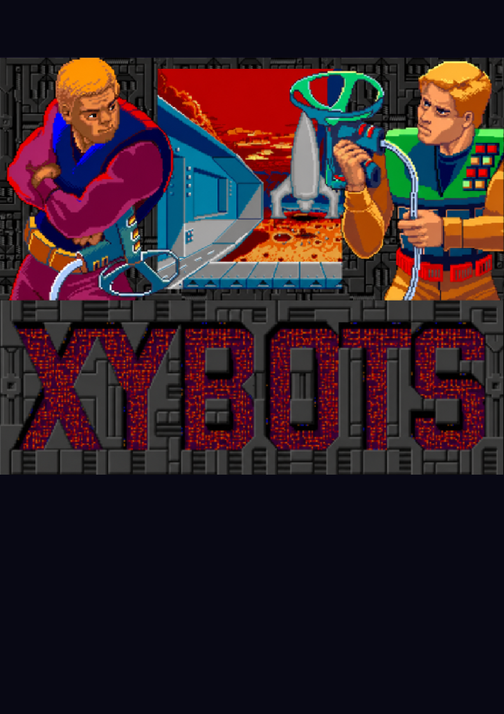
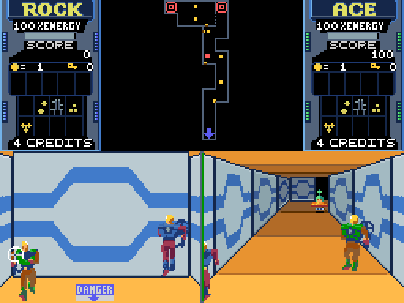
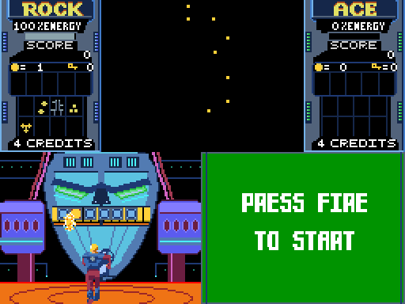
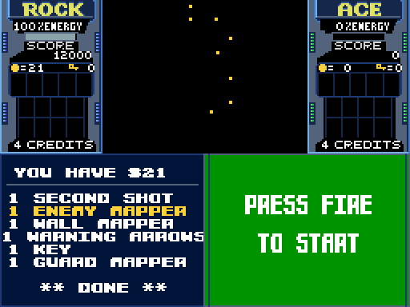
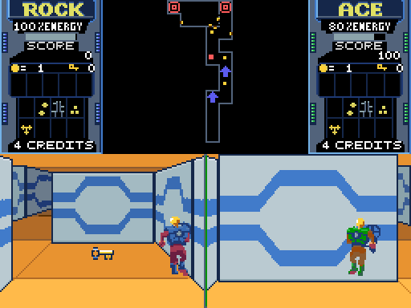

# Xybots for MSX1 + V9990

**An MSX cartridge version of Xybots with V9990 graphics, two-player play and optional Moonsound audio.**

An unofficial homage port by **DiHalt Studio**, 2026.

  

## Play it

Download the 2 MiB ASCII16 ROM from [Releases](https://github.com/DiHaltStudio/Xybots-V9990/releases), then place it in release/ as release/xybots.rom. You need an MSX1 or later with 64 KB RAM and a V9990 cartridge. A Moonsound adds the arcade music and voices; expanded Moonsound sample RAM also enables selected arcade effects.

Run make run to play the release ROM in openMSX, or make run-moon to add Moonsound. Use make run2 or make run2-moon to connect a second joystick. The run targets play the release ROM without needing the original game files.

The [English manual](docs/manual/manual-en.pdf) and [Spanish manual](docs/manual/manual-es.pdf) cover setup, the panel, the shop and the rules.

| Action | Player 1 | Player 2 | Joystick |
|---|---|---|---|
| Walk / step sideways | Cursor keys | W A S D | Direction |
| Turn | N / M | Shift + A / D | Button B + left / right |
| Fire | Space | Ctrl | Button A |
| Special attack | Space + down | Ctrl + S | Button A + down |
| Pause / resume | P | P | — |

Rock and Ace cross the Xybots' mazes, defeat robots, collect keys and coins, and find each level's exit. Each player has a separate view; a second player can join during play.

## Screenshots

| The maze | Master Xybot | The shop |
|:---:|:---:|:---:|
|  |  |  |

  

<em>Two player panels and the shared minimap.</em>

## What this port contains

The cartridge keeps the MSX game's maze, actors, rules and score system. It adds V9990 artwork with a shared 64-colour palette, a new panel and minimap, a cartridge opening picture, two-player keyboard controls and a pause key. The original MSX sound is available without Moonsound.

The editable graphics are in assets/. The source in src/ and the converters in tools/ assemble the original tape program into the V9990 cartridge.

## Building from source

The original Xybots MSX tape and arcade audio exports are **not distributed here**. Place your own XYBOTS.CAS and audio exports under the ignored original/ folder, then run make. The build extracts the tape, applies the port's patches and produces build/xybots.rom.

[Building instructions](docs/BUILDING.md) list every external input, the tools and all build targets. You can rebuild the manuals with make manual. The ROM and release zip are generated by make release and belong on a GitHub release, not in the repository.

## Repository layout

| Path | Contents |
|---|---|
| src/ | Z80 source for the V9990 runtime and cartridge loader |
| assets/ | Editable sprites, tiles, palettes, scenes, HUD and original port music |
| tools/ | Tape extractor, graphics converters and ROM builder |
| docs/ | Build and art guides, screenshots, English and Spanish manuals |
| original/ | Your own tape and arcade audio inputs; ignored by Git |
| build/ | Generated files; ignored by Git |
| release/ | ROM, PDFs and zip for a future release; generated files ignored |

## Make it better

Source code is available here. **Please improve the game if you feel so!** Art, music arrangements, hardware compatibility and documentation are all welcome areas for contributions.

## Credits and rights

Xybots was originally an arcade game by Atari Games (1987); the MSX game was published by Domark (Tengen) in 1989. The MSX title screen credits B. Costas for Z80 code and J. Tripp for 68000 code. The V9990 port is by DiHalt Studio.

This is an unofficial port made for study, preservation and homage, with no affiliation with the original rights holders. The Xybots name, game, graphics and arcade audio belong to their respective owners. MSX is a trademark of MSX Licensing Corporation. The V9990 chip photo in the manuals is credited there.
